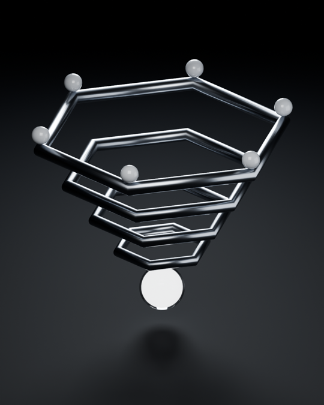
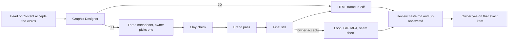

# Dreamstate Design

Graphic design for the Dreamstate GTM team, in 2D and 3D. HTML frames and templates for posts, carousels, thumbnails and diagrams, plus a scripted 3D lane in Blender for one scroll-stopping hero object per post.



*The sample scene, `signal-funnel`, rendered headless in Blender 5.2 with the grey stand-in palette. The owner's palette comes from `brand.local/`.*

## What is in here

| Folder | What it is |
|---|---|
| [docs/](docs/start-here.md) | Start here, rules, best practices, the 3D playbook |
| [brand/](brand/AGENTS.md) | Blank brand forms, including the 3D palette. The filled copy is `brand.local/`, never committed |
| [2d/](2d/README.md) | Copied gtm-team and funnel templates, frame shells and render scripts, plus 9 visual skills including our own `viral-gif-studio` |
| [3d/](3d/README.md) | Our Blender lane: helper library, scripted scenes, render, GIF, MP4 and seam scripts, prompts, review checklist, bridge setup |
| [skills/](skills/README.md) | `build-3d-scene`, `rebrand-3d-scene`, `review-3d-render` |
| [setup-prompt.md](setup-prompt.md) | Paste into the Graphic Designer bot to point it at this repo |

## How a piece moves



## Quick start

```sh
npm install && npx playwright install chromium
brew install --cask blender && brew install ffmpeg
3d/scripts/render.sh signal-funnel clay still
3d/scripts/render.sh signal-funnel final still
npm run check
```

Full setup: [docs/start-here.md](docs/start-here.md).

## Part of the Dreamstate GTM team

| Repo | What it is |
|---|---|
| [dreamstate-gtm-team](https://github.com/luisfigueroavale/dreamstate-gtm-team) | The seats, the rules, the setup prompt |
| [dreamstate-linkedin-funnel](https://github.com/luisfigueroavale/dreamstate-linkedin-funnel) | The content desk and its skills |
| [dreamstate-launch-videos](https://github.com/luisfigueroavale/dreamstate-launch-videos) | The launch video library |
| dreamstate-design | This repo |

## License

MIT. See [LICENSE](LICENSE). The Blender bridge is a separate MIT package that is installed, not copied, here. See [3d/mcp/README.md](3d/mcp/README.md).
